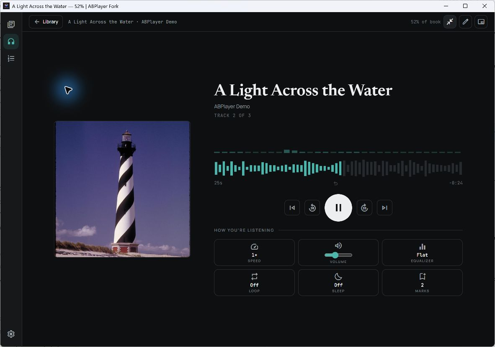
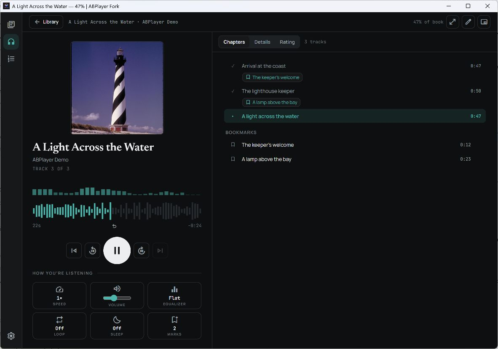
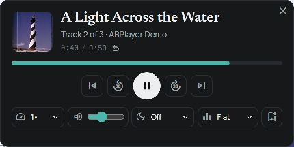
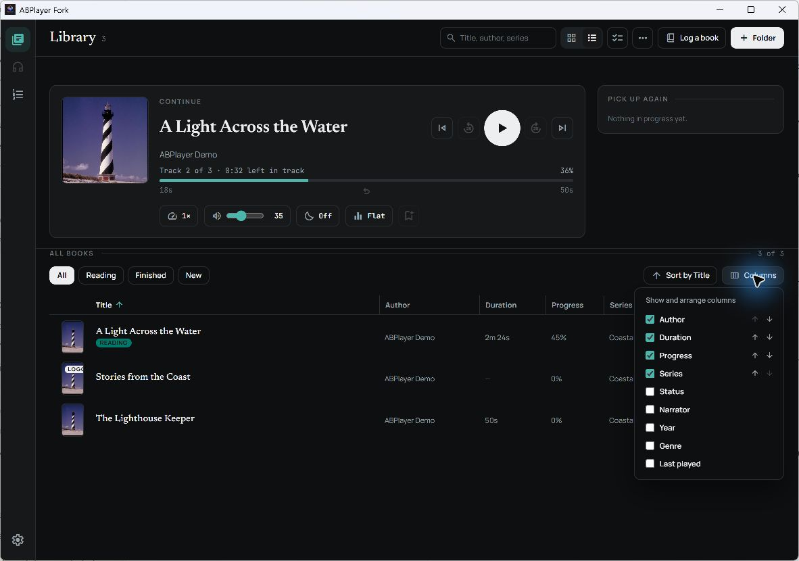
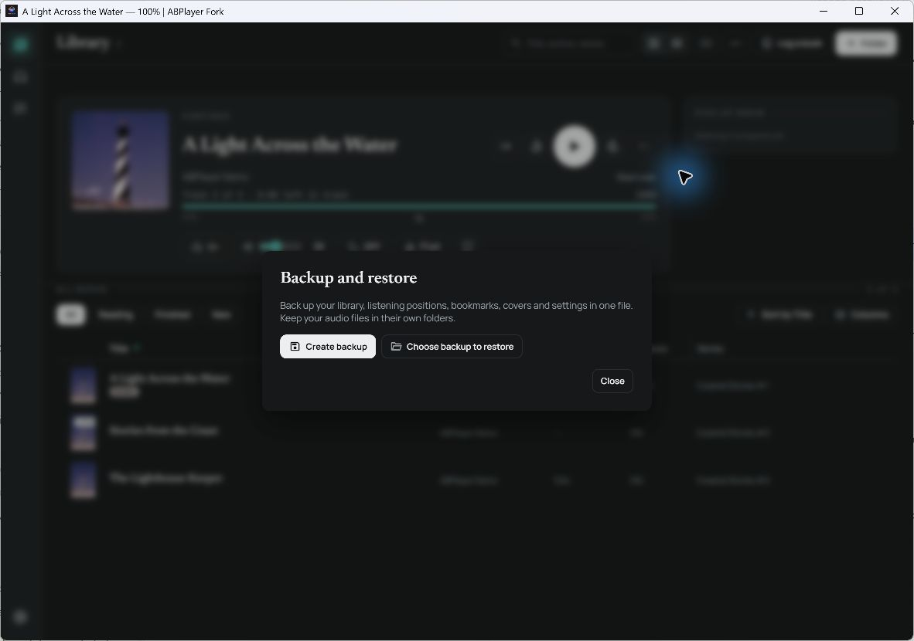

# ABPlayer Enhanced

An ABPlayer fork with a tray mini player, configurable library columns, playback visualizations and full library backups.



## What's added

| Feature | What you can do |
| --- | --- |
| Chapter and track buttons | Move between chapters or files from the main player, the library's Continue card and the mini player. |
| Undo seek | Return to the time and track before the last manual jump with the undo button or **Ctrl+Z**. A timeline drag counts as one seek. |
| Bookmarks inside the chapter list | See bookmarks below the matching chapter or track and jump straight to a saved moment. |
| Tray controls | Keep the player in the Windows notification area and choose whether closing the window hides it there. |
| Mini player | Control playback, chapters, volume, speed, sleep, EQ and bookmarks from a compact window that stays on top. Choose a single or double tray click and repeat the gesture to restore the main window. |
| Mini player opacity | Adjust the background from 50% to 100% opacity in **Settings → Theme**. Text and controls remain fully opaque. |
| Expanded player | Fill the content area while keeping the sidebar and player header available. |
| Audio visualizations | Choose a spectrum, an oscilloscope, a level meter or Off in **Settings → Audio**. |
| Library columns | Add, hide and rearrange optional columns. Click a heading to sort and click it again to reverse the direction. |
| Metadata lookup | Search Open Library by title, author or ISBN and review the fields before saving them. |
| Stream Deck hotkeys | Assign global keyboard shortcuts for playback, volume, mute and bookmarks. |
| Full profile backups | Save the library, listening positions, bookmarks, covers, settings, tier lists and statistics in one file. Remap audiobook folders when restoring on another PC. |
| Installer maintenance | Update an existing Fork installation in place, repair installed files or uninstall. Updates and repairs preserve the profile. |

## A closer look

### Bookmarks and chapter navigation



### Mini player



### A library arranged your way



The chosen columns, their order and the sort direction are saved between sessions.

### Backup and restore



Open **Library → … → Backup and restore** to save an `.abplayer-backup` file. Keep your audio files separately. When restoring, review the archive, choose replacement folders if needed and select **Restore on next launch**. The previous profile is kept as a safety copy.

All screenshots on this page are captured from the running Windows application using an isolated demonstration profile and sample audio. The sample cover photograph is credited in [Screenshot provenance](docs/screenshots/README.md).

## Quick controls

| Shortcut | Action |
| --- | --- |
| Ctrl+Z | Undo the last seek while the player is focused |
| Ctrl+Shift+P | Play or pause globally |
| Ctrl+Shift+M | Toggle the mini player globally |
| Ctrl+Alt+Shift+1 | Play or pause through an enabled Stream Deck hotkey |
| Ctrl+Alt+Shift+2 / 3 | Lower / raise volume by 5 percentage points |
| Ctrl+Alt+Shift+4 | Mute or unmute |
| Ctrl+Alt+Shift+5 | Add a bookmark |

Enable the Stream Deck hotkeys in **Settings → Stream Deck**, then assign **System → Hotkey** actions in the Elgato app.

## Build

Install Node.js, Rust and the Windows prerequisites listed in the Tauri documentation.

```sh
npm ci
npm run tauri build
```

The installed app is named **ABPlayer Fork**. Its Windows profile is stored in `%APPDATA%\com.ironpanda666.abplayer`.

[Tauri prerequisites](https://v2.tauri.app/start/prerequisites/)

## Project status

The Windows build is version **1.7.3**. The frontend suite has 165 passing tests. Standalone backup tests cover folder relocation and preservation of the previous profile. The complete native test suite encountered a Windows test-loader error. Physical Stream Deck hardware still needs hands-on verification.

Open Library receives the query when you select **Search**. Imported catalog fields are stored in the player's library.

## Upstream and notices

Based on [ABPlayer by jhidalgo_dev](https://github.com/kurohige/ABPlayer). The original documentation is preserved in [docs/upstream/README.md](docs/upstream/README.md).

The upstream project reserves all rights. Its copyright notices and third-party license notices continue to apply. Public installer distribution requires permission from the upstream rights holder or an applicable license.

The custom installer includes Tauri's MIT notice in [src-tauri/installer/LICENSE-TAURI-MIT](src-tauri/installer/LICENSE-TAURI-MIT).

---

Developed with AI-assisted vibe coding using OpenAI Codex.
